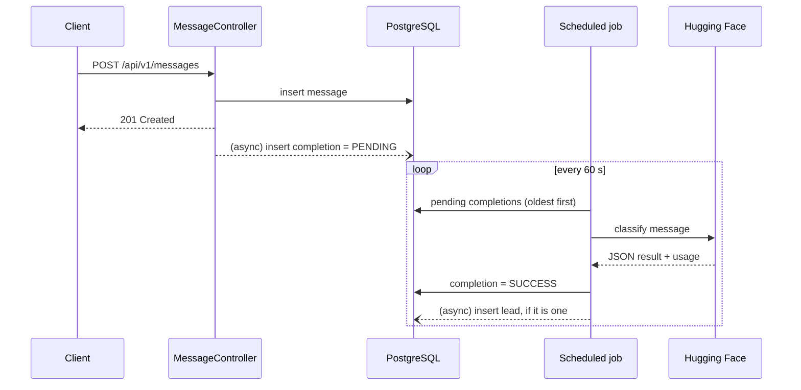

# Smart Lead

Receives contact messages (an email or phone number plus free text), classifies them with an LLM
(Hugging Face, `openai/gpt-oss-120b:groq`) and stores the ones that look like sales leads.

## How it works

1. A client sends `POST /api/v1/messages`. The message is validated and saved, and the API answers right away.
2. In the background, a `PENDING` row is added to `hf_completions` for that message.
3. A scheduled job (every 60 seconds after the previous run finished) takes up to `batch-size` pending rows
   and asks the model to classify each message with a JSON schema.
4. The answer is stored on the completion (`SUCCESS`, with token usage). If the message is a lead, a row is added to `leads`.
5. Temporary failures (rate limit, timeouts) leave the row `PENDING` for the next run. Permanent ones (HTTP 400, 413, 422)
   mark it `ERROR`. When the daily request limit is used up, the job pauses until it resets.

## Architecture

```mermaid
flowchart LR
    client([Client]) -->|X-API-KEY| security
    browser([Swagger UI]) -->|HTTP Basic| security

    subgraph app [Spring Boot application]
        security[Security filters]
        security --> mc[MessageController<br/>POST/GET /api/v1/messages]
        security --> lc[LeadController<br/>GET /api/v1/leads]
        security --> cc[CompletionController<br/>GET /api/v1/completions]

        mc --> ms[MessageService]
        lc --> ls[LeadService]
        cc --> cs[CompletionService]

        ms -->|submitMessageAsync<br/>@Async| hf[HuggingFaceService]
        job([Scheduled job<br/>every 60 s]) --> hf
        hf --> rl[Rate limiter]
        hf -->|submitLeadAsync<br/>@Async| ls
    end

    ms --> db[(PostgreSQL<br/>messages, hf_completions, leads)]
    ls --> db
    cs --> db
    hf --> db
    hf -->|chat completions| hfapi[[Hugging Face router]]
```



| Package | Contents |
|---|---|
| `controller` | REST endpoints |
| `service.message`, `service.lead`, `service.completion` | Business logic, DTOs and filters |
| `service.hgface` | Hugging Face client, rate limiter and the scheduled processing |
| `domain` | JPA entities and Spring Data repositories |
| `config` | Security, OpenAPI, async executor, HTTP client |
| `exceptions` | Error types and the global exception handler |

Database schema changes are Liquibase changelogs in `src/main/resources/db/changelog/<yyyy>/<mm>/<ddHHMM>-<name>.xml`.
Hibernate only validates them (`ddl-auto: validate`).

## Requirements

- Java 25
- Docker (PostgreSQL for local runs, and Testcontainers for the tests)
- A [Hugging Face access token](https://huggingface.co/settings/tokens)

The Maven wrapper (`./mvnw`) is included, so Maven does not need to be installed.

## Setup

### 1. Start PostgreSQL

```bash
docker run -d --name smart-lead-db \
  -e POSTGRES_USER=postgres -e POSTGRES_PASSWORD=postgres -e POSTGRES_DB=smart-lead \
  -p 5432:5432 postgres:17-alpine
```

The tables are created by Liquibase when the application starts.

### 2. Configure

The application reads these environment variables:

| Variable | Required | Default | Purpose |
|---|---|---|---|
| `API_KEY` | yes | | Value clients send in the `X-API-KEY` header |
| `SWAGGER_LOGIN` | yes | | Swagger UI user name |
| `SWAGGER_PASSWORD` | yes | | Swagger UI password |
| `HUGGING_FACE_TOKEN` | yes | | Hugging Face access token |
| `DATABASE_URL` | no | `jdbc:postgresql://localhost:5432/smart-lead` | JDBC URL |
| `POSTGRES_USER` | no | `postgres` | Database user |
| `POSTGRES_PASSWORD` | no | `postgres` | Database password |
| `PORT` | no | `7695` | HTTP port |

For local work you can put the values in `src/main/resources/application-local.yaml` (git-ignored) and run with the `local` profile:

```yaml
security:
  api-key: local-api-key
spring:
  security:
    user:
      name: swagger
      password: swagger
hugging-face:
  token: <your token>
```

Never commit tokens.

### 3. Run

```bash
export API_KEY=local-api-key SWAGGER_LOGIN=swagger SWAGGER_PASSWORD=swagger HUGGING_FACE_TOKEN=<token>
./mvnw spring-boot:run
```

Or with the `local` profile file from above:

```bash
./mvnw spring-boot:run -Dspring-boot.run.profiles=local
```

The application listens on <http://localhost:7695>.

### 4. Try it

```bash
curl -X POST http://localhost:7695/api/v1/messages \
  -H 'X-API-KEY: local-api-key' -H 'Content-Type: application/json' \
  -d '{"contact": "john@acme.com", "message": "Hi, we would like a demo for 50 users."}'

curl -H 'X-API-KEY: local-api-key' http://localhost:7695/api/v1/completions
curl -H 'X-API-KEY: local-api-key' http://localhost:7695/api/v1/leads
```

After the next scheduled run (up to a minute) the message appears as a lead if the model classified it as one.

## API

All endpoints require the `X-API-KEY` header, except `/actuator/health`.
Swagger UI is at `/swagger-ui.html` (HTTP Basic with `SWAGGER_LOGIN` / `SWAGGER_PASSWORD`),
and the OpenAPI document at `/v3/api-docs`.

| Method and path | Description |
|---|---|
| `POST /api/v1/messages` | Submit a message |
| `GET /api/v1/messages` | Search messages (id, email, phone, ip, date range; paged) |
| `GET /api/v1/messages/{id}` | One message |
| `GET /api/v1/leads` | Search leads (type, urgency, message id, date range; paged) |
| `GET /api/v1/leads/{id}` | One lead |
| `GET /api/v1/completions` | Search completions (status, message id, date range; paged) |
| `GET /api/v1/completions/{id}` | One completion |
| `GET /api/v1/completions/message/{messageId}` | The completion of a message |

List endpoints take `page` (default 0), `size` (default 100, max 5000), `sortBy` and `direction` (`asc` or `desc`).
Every response is wrapped in `BaseResponse`: the data is in `payload`, and errors have a negative `code`
(`-10` not found, `-20` invalid request, `-30` unauthorized, `-99` internal error).

## Tests

```bash
./mvnw test          # unit, JPA and integration tests
./mvnw verify
```

Docker must be running. One PostgreSQL container (Testcontainers) is shared by all database tests,
and the schema comes from the same Liquibase changelogs as in production. The Hugging Face client is mocked.

## Docker

```bash
docker build -t smart-lead .
docker run --rm -p 7695:7695 \
  -e API_KEY=... -e SWAGGER_LOGIN=... -e SWAGGER_PASSWORD=... -e HUGGING_FACE_TOKEN=... \
  -e DATABASE_URL=jdbc:postgresql://host.docker.internal:5432/smart-lead \
  smart-lead
```

## CI

`.github/workflows/ci.yml` builds and tests on pull requests to `main` and `develop` and on pushes to `main`,
then checks that the Docker image builds.
